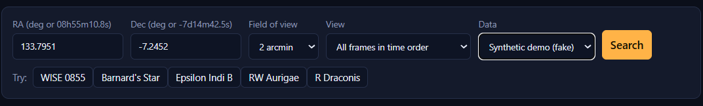

# SPHEREx Blink

A web tool for the **2026 NASA Space Apps Challenge: "Planet X and SPHEREx"**.
You type in a spot in the sky, and it shows a short looping "video" of SPHEREx telescope images of that spot, so anything that moves is easy to notice.

---

## 1. The challenge in plain words

NASA's **SPHEREx** space telescope photographs the whole sky again and again, in 102 different colours of infrared light. It produces far more images than any person (or even a computer program) can look through.

Astronomers use a simple trick to find things in such images:

- Take two photos of the same patch of sky on different dates.
- Almost everything stays put, because stars are extremely far away.
- Things that are **close to us** shift position: comets, asteroids, brown dwarfs and nearby stars.
- Spot the dot that moved, and you may have found something. This is how **Pluto** was discovered.

Volunteers have already found hundreds of comets, stars and brown dwarfs this way (for example through [backyardworlds.org](https://backyardworlds.org)). NASA now wants a tool that lets the public do the same with SPHEREx data.

### What we have to build

> A **public web tool** where a user enters the coordinates of a patch of sky (Right Ascension and Declination). The tool shows a series of SPHEREx images of that patch, like a little video, making it easy to spot moving objects.

We are **not** expected to discover anything ourselves. We are building the tool that helps everyone else look.

### Test targets given by the challenge

| Target | What it is | Why it is a good test |
|---|---|---|
| **WISE 0855** (RA 08h55m10.831s, Dec -7d14m42.53s) | A very cold, fast-moving brown dwarf | Moves quickly, so it should be easy to see |
| **Barnard's Star** | A nearby star | Has a large motion across the sky |
| **Epsilon Indi B** | A pair of brown dwarfs orbiting a star | A moving, multi-object system |
| **RW Aurigae** | A variable star | Changes brightness |
| **R Draconis** | A variable star | Changes brightness |

### Optional ideas from the challenge

- Make it easy to update when new SPHEREx data arrives (new data comes out weekly).
- Combine ("stack") all images from each of the six detector arrays to make faint things clearer.
- Show spectra (brightness vs. colour) on the fly. The challenge calls this "extra kudos".
- Let users add or subtract images taken at different times.
- Let users choose the field of view (a bigger area catches faster movers but takes longer to load).
- Overlay data from other telescopes, such as Gaia or WISE.
- Accept coordinates in the web address (URL), so the tool can be embedded in other websites.
- Show metadata such as contamination flags.
- Use existing tools such as Astropy and Aladin.

---

## 2. Words explained

| Word | Meaning |
|---|---|
| **SPHEREx** | A NASA space telescope launched in 2025. It maps the whole sky every six months in 102 colours of near-infrared light. |
| **IRSA** | The NASA/IPAC Infrared Science Archive, run by Caltech. It is NASA's online library for infrared telescope data. **SPHEREx's images are stored there**, and it lets programs download them. In this project, "IRSA" simply means "where we get the SPHEREx photos from". |
| **Cutout** | Instead of downloading a huge full image (about 70 MB), we ask IRSA for only a small square around our spot. This is much faster. |
| **WISE** | An older NASA infrared space telescope. It matters here in two ways: (1) **WISE 0855** is one of our test objects, a brown dwarf that WISE discovered; (2) WISE data is an optional overlay we could add to our images. |
| **RA and Dec** | Right Ascension and Declination. The sky's version of longitude and latitude. Two numbers give an "address" for any spot in the sky. |
| **Brown dwarf** | An object bigger than a planet but too small to be a star. It is dim and cold, and nearby ones can move noticeably across the sky. |
| **Gaia** | A European Space Agency telescope that measures the positions and motions of over a billion stars. An optional overlay. |
| **Aladin** | A free sky-viewer tool from the CDS data centre in Strasbourg, which can be embedded in websites. |
| **Detector array** | SPHEREx has six detectors. Each sees a different range of infrared colours. |
| **Stacking** | Adding several images together so faint objects become clearer. |
| **Difference image** | Subtracting one image from another so that everything static disappears and only the things that changed or moved remain. |

---

## 3. What the tool looks like

The top of the page is the search panel:



*Screenshot taken with "Synthetic demo (fake)" selected, so it uses generated images, not real SPHEREx data.*

What each part does:

- **RA / Dec:** the sky position. Accepts decimal degrees (`133.7951`) or the `08h55m10.8s` / `-7d14m42.5s` style.
- **Field of view:** how big a patch to show (1 to 10 arcminutes).
- **View:** *All frames in time order* (the blink animation), *Stack by detector* (combine images to reduce noise), or *Difference* (highlight movers).
- **Data:** *Live SPHEREx (IRSA)* uses real data. *Synthetic demo (fake)* uses generated images so the interface can be shown without internet access. It always displays a red warning banner.
- **Try buttons:** one click loads each of the five test targets.

Below the panel are the image viewer, a frame info box (date, detector, wavelength, flags) and a play, pause and scrub bar.

---

## 4. Project goal

A working website, using **real SPHEREx data**, where anyone types coordinates and watches an animation that makes moving objects easy to spot.

**Must have:** coordinates in, aligned time-lapse out, works on the five test targets.
**Should have:** stack by detector, difference mode, frame metadata, a deployed link.
**Stretch:** spectra on the fly, Gaia/WISE overlay, automatic pickup of new weekly data.

---

## 5. Project details

### What it does

SPHEREx Blink lets a user enter a sky position as decimal or sexagesimal
coordinates and view real SPHEREx images of that area over time. The images
are aligned to a common north-up, east-left grid so that changes and moving
objects are easier to inspect.

The tool provides three views:

- **All frames:** shows observations in time order as a blink animation.
- **Stack by detector:** combines frames from each detector to improve
  visibility of faint sources.
- **Difference:** subtracts a reference image to highlight changes.

It also displays frame metadata and provides a spectrum API for extracting
flux, error, wavelength, date, and detector values at a selected pixel.

### Benefits and intended impact

The project makes archival infrared data easier for non-specialists to
explore. Instead of inspecting large FITS files manually, users can enter a
position and quickly compare observations to look for moving or changing
objects such as brown dwarfs, nearby stars, asteroids, and comets.

The intended impact is to help more people participate in identifying
interesting sources in SPHEREx data and to support public discovery of nearby
or moving objects.

### Tools and technologies

- Python 3.10+
- FastAPI and Uvicorn for the API and web server
- HTML, CSS, and vanilla JavaScript for the browser interface
- Astropy for coordinates, FITS files, and WCS
- `reproject` for common-grid image alignment
- NumPy and Pillow for image processing and PNG output
- NASA/IPAC IRSA for real SPHEREx data and cutouts
- Gaia and SIMBAD as astronomical reference sources for target verification

### Creativity and design considerations

The project combines an accessible blink animation with detector stacking,
difference imaging, wavelength metadata, and a spectrum endpoint. The team
considered real-data validity, changing wavelengths between observations,
proper motion, image alignment, intermittent archive failures, response time,
and the need to keep synthetic data clearly labelled as fake.

The design prioritizes a small, understandable tool that works with real
archive data rather than presenting synthetic results as discoveries.

---

## 6. Run it

You need Python 3.10 or newer.

```bash
pip install -r requirements.txt
python -m uvicorn backend.app:app --port 8000
# open http://127.0.0.1:8000
```

Check that the real data path works:

```bash
python -m backend.irsa_check
```

Run the local API verification:

```bash
python scripts/verify_api.py
```

This checks health, live frames, all three views, detector coverage,
wavelengths, spectrum output, caching and invalid input handling.

URL queries work for embedding:
`/?ra=08h55m10.831s&dec=-7d14m42.53s&fov=2&mode=single&source=live`

The current SIMBAD-based coordinates for the five test targets are recorded
in [`docs/targets.md`](docs/targets.md).

---

## 7. Current status (honest)

| Part | State |
|---|---|
| Interface, player, stack/diff modes, URL parameters, coordinate parsing | Working locally |
| Synthetic demo mode | Working. **Fake data**, always labelled in the UI |
| Live IRSA pipeline (`backend/irsa.py`) | Working locally with real SPHEREx data |
| Wavelength, detector and flag metadata | Working locally |
| Spectrum endpoint | Working locally with real frame data |
| Public deployment and mobile testing | Not tested |

Known caveats:

- IRSA can temporarily return HTTP 503 or no usable cutouts, so frame counts
  and load times can vary.
- The first live request can take several seconds; cached repeats are faster.
- The five SIMBAD-based target coordinates are listed in `docs/targets.md`.
- A frame's brightness can change because the observed wavelength changed, not because the object is variable.
- SPHEREx pixels are about 6.2 arcseconds wide, so slow movers show only subtle motion.

Latest local verification on `main`:

- Single/live view: 58 frames in 16.9 seconds.
- Stack/live view: 30 frames.
- Difference/live view: 58 frames.
- Spectrum: 57 valid non-synthetic points.
- All automated API checks passed.
- Full findings are recorded in [`docs/Finding.md`](docs/Finding.md).

---

## 8. Project layout

```
backend/app.py        API (/api/frames, /api/targets) and page hosting
backend/irsa.py       IRSA query, cutouts, alignment to a common grid, disk cache
backend/imaging.py    stacking, differencing, contrast stretch, PNG encoding
backend/demo.py       synthetic (fake) frames
backend/irsa_check.py first test to run with real internet access
backend/spectrum.py   spectrum extraction
frontend/index.html   the single-page viewer
scripts/verify_api.py automated API verification
scripts/warm_cache.py prefetch real target data
docs/                 screenshots, role task files (docs/roles/), notes
docs/targets.md       SIMBAD-based target coordinates
docs/Finding.md       test findings and limitations
AGENTS.md             shared context and rules for AI coding agents and the team
CLAUDE.md, .github/copilot-instructions.md   point agents to AGENTS.md
```

## 9. Team roles

Each person has a detailed task file for themselves and their coding agent:

| Role | File |
|---|---|
| A, Data | `docs/roles/A-data.md` |
| B, Image and science | `docs/roles/B-image-science.md` |
| C, Frontend | `docs/roles/C-frontend.md` |
| D, Product, deploy and presentation | `docs/roles/D-product-deploy.md` |

## 10. Credits

SPHEREx data comes from NASA/IPAC IRSA. If you publish results, include the acknowledgement requested by IRSA for SPHEREx data products.
